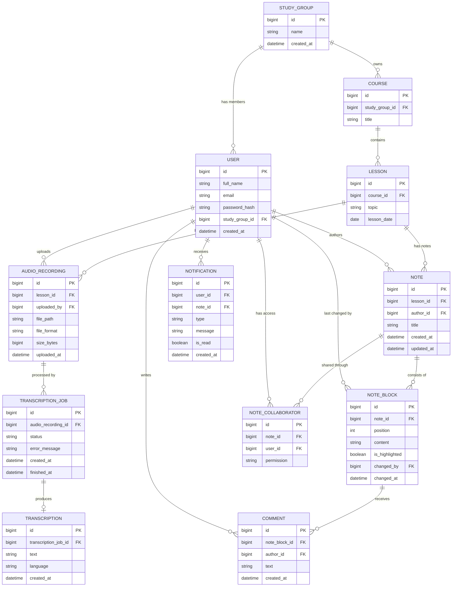

# Lectnote — ERD

Conceptual model: 12 entities. Real-world objects: User, StudyGroup, Course, Lesson, AudioRecording, Transcription, Note, NoteBlock, Comment, Notification. Service entities: TranscriptionJob, NoteCollaborator.

## Open points

- **D-02:** one audio recording can have several transcription jobs, so a failed job can be retried.
- **D-03:** comments are deleted together with their block.
- **D-04:** the model has no version attribute, so the last saved edit wins.
- **D-06:** `language` is stored in `Transcription`; where the value comes from is still undecided.
